# Architecture

The application serves one local browser conversation. Python runs FastAPI and Pipecat;
the browser runs a bundled plain JavaScript client in a Jinja page. HTMX saves Settings
without replacing the active conversation panel.

## Components

| Component | Responsibility |
|---|---|
| `main.py` | Load credentials, validate files, warm VAD, register routes, drain resources on shutdown. |
| `routers/browser.py` | Talk page, POST/PATCH offer, and explicit End HTTP endpoint. |
| `services/browser_session.py` | Own the single peer, readiness tasks, runner, and once-only cleanup. |
| `services/transport_factory.py` | SmallWebRTC with audio-only pipeline frames fixed at 16000 Hz. |
| `services/pipecat_pipeline.py` | Build services/processors, attach observers, run the pipeline, and report its result. |
| `runtime.py` | The only active-session data registry; JSON-safe values, no provider objects. |
| `services/runtime_config.py`, `config_store.py` | Validated config cache, serialized saves, immutable snapshots. |
| `storage.py` | Atomic local JSON config/history files. |
| `routers/dashboard.py` | Settings and saved transcript/metrics views. |

## Audio and event flow

```mermaid
flowchart LR
    Browser[Browser] <-->|SmallWebRTC audio/events| Transport
    Transport --> Gate[User audio gate]
    Gate --> STT[Sarvam realtime STT]
    STT --> Hint[Language hint]
    Hint --> Memory
    Memory --> User[User aggregator]
    User --> LLM[Cerebras Qwen - reasoning disabled]
    LLM --> Prefix[Language prefix]
    Prefix --> TTS[Sarvam Bulbul v3]
    TTS --> Output[Transport output]
    Output --> Assistant[Assistant aggregator]
    Output --> Browser
```

Sarvam realtime uses `saaras:v3-realtime`, `mode=transcribe`, and `language_code=auto`.
A small STT adapter is needed because Pipecat 1.2.1 ships only the legacy Sarvam STT endpoint.
`session.begin` establishes readiness; partials are interim frames. Speech start latches mute
acceptance. Speech end alone does not release a turn: an accepted final commits through the
existing collector before its finalized transcript and stop frame enter the aggregation path.
A per-utterance latch rejects duplicate finals before memory or generation. Collector rejection
also suppresses the transcript frame, so history and replies share the same acceptance decision.
The LLM emits `<en>`, `<hi>`, `<kn>`, `<mr>`, or `<te>`; the prefix processor sends a typed
Sarvam TTS language update before streaming tag-free text. The built-in websocket TTS service
uses stable `bulbul:v3`, voice `shubh` by default, and native 16 kHz linear16 mono output.
Flux eager EOT and speculative drafts remain in source for historical tooling but are unavailable
for the Sarvam path; an ordinary partial is never treated as an eager signal.
The input gate sends silence during bot speech. Rejected transcripts cannot update memory, history,
or eager drafts. Browser mic gating follows the same no-barge-in policy.

Observers are registered on `PipelineTask`, including `UserBotLatencyObserver` and
the existing turn-metrics observer. `SileroVADAnalyzer()` remains in user-aggregator params.
Pipecat 1.2.1 automatically supplies RTVI; no duplicate RTVI observer is registered.
Client-js 1.9.0 and SmallWebRTC transport 1.10.2 match its RTVI 1.3.0 protocol.

## Session lifecycle

The session manager reserves its slot before initializing a peer and retains the connection
and tasks on `app.state`. The pipeline hands it the task and STT-readiness callback before
running. Matching active peer IDs renegotiate; unknown IDs and concurrent starts are rejected.

The browser completes the RTVI handshake and starts playback of the silent remote track.
It then sends `ui-ready`; blocked playback has an Enable audio button.
The server waits for media, RTVI, UI, and Sarvam session readiness, then queues the configured greeting once.
Microphone input stays muted through the greeting. The browser enables input after the first
greeting speaking-stop callback, respecting the user's Mute selection.

End, disconnect, provider failure, setup timeout, and shutdown request the same cleanup task.
Callbacks signal cleanup without waiting for their own runner. Cleanup cancels pending work,
awaits pipeline cancellation/runner completion, finalizes once, atomically saves, closes the peer,
and removes runtime state after saving. HTTP waits have a deadline, but the retained cleanup task
keeps waiting for actual runner completion before finalizing once. A slow stop does not discard history.
A failed write retains the finalized payload in memory for an End retry; no second finalization occurs.
A runner that never stops blocks replacement sessions and may require a process restart.

## Boundaries

- One process/worker and one conversation. No multi-user, background worker, media relay, or public hosting.
- Browser/device codec rates can differ; SmallWebRTC converts at the fixed 16 kHz pipeline boundary.
- API keys stay server-side. Behavior is in local JSON and snapshotted per conversation.
- History uses a versioned envelope around the existing `CallLog`; no MongoDB migration.
- Backend timing is not measured browser-speaker latency. Audible behavior requires human validation.

See [configuration](CONFIGURATION.md), [metrics](METRICS.md), [runbook](RUNBOOK.md), and
[ADR-006](decisions/ADR_006_BROWSER_LOCAL_FILES.md).
