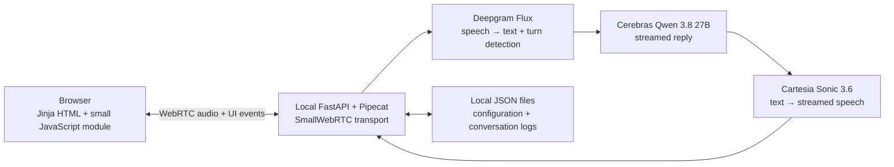

# Browser voice agent: reviewed implementation plan

Historical conversion plan. The later [repair plan](BROWSER_REPAIR_PLAN.md) supersedes its
model choice, browser package pins, eager/speculative restrictions, and shutdown handling.

Reviewed against this repository, installed Pipecat APIs, and current official documentation on **16 October 2026**. Scope: one person using a browser on the same computer as Python.

**Build one browser voice agent using the existing Python/Pipecat pipeline, Jinja/HTMX pages, SmallWebRTC, and local JSON files. Remove Exotel and MongoDB from the application. React is unnecessary.**

The user talks and listens in the browser. Python runs locally and connects to Deepgram, Cerebras, and Cartesia using server-side API keys. This is an online, provider-backed agent with a browser interface; moving the existing Python pipeline and all model inference into browser JavaScript would require a different project.

This document records the reviewed conversion contract. The browser/local-file implementation now follows it; credentials remain unchanged. Non-live tests and silent WebRTC checks do not validate audible voice behavior.

## 1. The complete design



One FastAPI process and one Uvicorn worker serve the page, configuration, history, and connection setup. Bind to `127.0.0.1` and use same-origin requests. One Pipecat pipeline handles one conversation.

**Storage decision:** use local files, as requested. Python reads and writes the configuration and conversation history directly. The runtime needs Python and access to the three model providers. Exotel, MongoDB, and the public tunnel are removed completely.

SmallWebRTC provides direct browser-to-Python media without another media-provider account. On the same computer, begin with local connections and no STUN/TURN infrastructure. [Pipecat server transport](https://docs.pipecat.ai/api-reference/server/services/transport/small-webrtc).

## 2. Keep the frontend small

Keep **Jinja + HTML + CSS + the existing HTMX**. HTMX continues to save configuration and load history fragments. Use ordinary JavaScript for microphone control, live audio, connection state, and transcript updates. HTMX exchanges HTML over HTTP; it does not replace the WebRTC audio client. [HTMX documentation](https://htmx.org/docs/).

The installed browser package pair resolves successfully. The automated local-peer test also verifies the server RTVI handshake; an actual browser voice session still needs human validation:

- `@pipecat-ai/client-js@1.13.1`
- `@pipecat-ai/small-webrtc-transport@1.10.8` (declares client `~1.13.0` as a peer).

Use **esbuild as the only new frontend build tool** and plain JavaScript with JSDoc. Put the source and package manifest in `frontend/`; `npm --prefix frontend ci` and `npm --prefix frontend run build` must create `app/static/demo.js`, served at `/static/demo.js`. Commit exact dependency versions and the npm lockfile; ignore `node_modules` and generated assets. Do not force-install incompatible peers. Node is only needed to build. [Client manifest](https://github.com/pipecat-ai/pipecat-client-web/blob/main/client-js/package.json), [transport manifest](https://github.com/pipecat-ai/pipecat-client-web-transports/blob/main/transports/small-webrtc-transport/package.json).

Pipecat's JavaScript SDK supplies device management, audio tracks, connection methods, and events without requiring React. [Pipecat JavaScript SDK](https://docs.pipecat.ai/api-reference/client/js/overview).

Create `app/templates/demo.html`, extending `_base.html`, with Start, Mute, End, status, and live text. Keep `/config` and `/calls`. Avoid swapping the active audio panel through HTMX: one JavaScript module owns one client instance. Serve the existing pinned HTMX locally rather than depending on its CDN. Startup must report a missing frontend bundle clearly.

Connect using `webrtcRequestParams: { endpoint: "/api/offer" }`. Older examples use deprecated `webrtcUrl`. [SmallWebRTC client API](https://docs.pipecat.ai/api-reference/client/js/transports/small-webrtc).

## 3. Provider choices, checked against current documentation

### Cerebras: use Qwen 3.8 27B with reasoning disabled

The model you mentioned exists: **`qwen-3.8-27b`**. The current shared-inference catalog lists it at approximately **1,850 tokens/second**, alongside `gpt-oss-120b` at approximately **3,000**. These are published output rates, not measured voice response times. Qwen is a suitable candidate because we can disable reasoning; parameter count alone does not establish which model replies sooner. [Cerebras model catalog](https://inference-docs.cerebras.ai/models/overview).

Use streaming with **`reasoning_effort="none"`**. Qwen defaults to high reasoning. Disabling it avoids generating a thinking response before the spoken answer; hiding reasoning text alone does not remove that work. Keep reasoning out of speech and captions. [Cerebras reasoning parameters](https://inference-docs.cerebras.ai/capabilities/reasoning), [streaming API](https://inference-docs.cerebras.ai/capabilities/streaming).

Keep Pipecat's existing `CerebrasLLMService` and its `https://api.cerebras.ai/v1` endpoint. No second LLM SDK or provider router is needed.

**Two implementation changes are required:**

1. Add a typed `llm.reasoning_effort` runtime setting, editable at `/config`, defaulting to `none` for Qwen. Pass it through `CerebrasLLMService.Settings(extra={"reasoning_effort": ...})`; the installed adapter merges this dictionary into the request.
2. Map our existing `llm.max_tokens` configuration value to **`Settings(max_completion_tokens=...)`**. The installed Cerebras request builder reads `max_completion_tokens`, while our `_build_llm()` currently sets `max_tokens`. Its present value therefore does not reach the request through that builder. Add a request-shape test for this exact boundary.

Keep the current short-answer prompt and initial 160-token limit as starting values. Check complete English/Hindi replies and the `<en>`/`<hi>` prefix contract with Qwen. If comparing GPT-OSS, select its supported `low` reasoning setting; it does not accept Qwen's `none` mode. Do not add automatic fallback behavior.

Validate the selected model/reasoning combination on config save: Qwen accepts `none`, `low`, `medium`, `high`; GPT-OSS accepts `low`, `medium`, `high`. An incompatible combination returns field errors rather than being translated silently.

### Deepgram: keep Flux Multilingual

Keep **`flux-general-multi`**, raw `linear16` audio at **16,000 Hz**, and English/Hindi hints. The hosted endpoint remains **`wss://api.deepgram.com/v2/listen`**. Flux already supplies the turn boundaries our pipeline uses. [Flux API reference](https://developers.deepgram.com/reference/speech-to-text/listen-flux).

The current multilingual documentation lists English and Hindi. On connection the wire parameter is repeated **`language_hint`**; `language_hints` is used in mid-stream Configure messages. Pipecat exposes `Settings.language_hints` and its installed adapter already performs that conversion. [Flux language documentation](https://developers.deepgram.com/docs/flux/language-prompting).

That documentation's Python SDK examples require v7+, while this repository pins `deepgram-sdk>=6.1.1,<7` and installs 6.1.1. The installed Pipecat Flux adapter builds its own WebSocket request. Retain the working adapter path; do not paste v7 SDK examples into it or upgrade the SDK blindly. Verify the outgoing model, hints, encoding, and sample rate.

Keep the existing turn thresholds initially. `eot_timeout_ms` is a maximum silence fallback, not a fixed delay charged to every turn. Our separate Pipecat `turn_stop_timeout_ms` debounce is another source of delay. Tune only after hearing the browser baseline. [Flux turn settings](https://developers.deepgram.com/docs/flux/configuration).

### Cartesia: use Sonic 3.6 over the existing streaming service

The current generally available model is **`sonic-3.6`**, with English, Hindi, and improved Hinglish support. Cartesia documents compatibility with Sonic 3.5. For repeatable demo behavior, use the documented stable snapshot **`sonic-3.6-2026-08-27`** in runtime configuration. Confirm the chosen voice with your refreshed key. [Cartesia current model](https://docs.cartesia.ai/build-with-cartesia/tts-models/latest).

Keep Pipecat's `CartesiaTTSService`, WebSocket speech streaming, sentence aggregation, raw `pcm_s16le`, and 16 kHz output. Keep our language-prefix processor before TTS. [Cartesia streaming API](https://docs.cartesia.ai/api-reference/tts/websocket).

The current integration and installed Pipecat adapter use API version `2026-03-01`. Retain it for the first compatibility check, then record the version actually tested with Sonic 3.6. The API version date and model snapshot are separate settings; changing the model does not mean changing the API version to the model's release date. [Cartesia API versioning](https://docs.cartesia.ai/use-the-api/api-conventions).

## 4. Remove the telephone code, reuse the agent code

| Area | Implementation action |
|---|---|
| `main.py` | Remove Exotel/Mongo lifespan wiring and telephony router registration. Initialize local storage/config and the live browser-session owner; register the browser router/static files and await session cleanup on shutdown. |
| `app/config.py` and `.env.example` | Remove `EXOTEL_*`, `PUBLIC_NGROK_URL`, `MONGO_*`, carrier/dialing settings, and legacy model/voice/prompt environment shims. Keep provider secrets and server settings. Never edit the real `.env`. |
| Telephony modules | Remove `app/routers/telephony.py`, `app/services/exotel_client.py`, and Exotel serializer construction after removing their callers. |
| `dashboard.py` and templates | Remove the outbound route, phone-number form, and `_outbound_status.html`. Preserve configuration and history. |
| `runtime.py` and storage helpers | Remove pending-outbound registries and outbound-attempt writes. Keep JSON-safe active sessions, snapshots, transcript, and metrics helpers. Replace `app/database.py` with a small `app/storage.py` using Python's standard library. |
| `transport_factory.py` and pipeline | Replace Exotel with audio-only SmallWebRTC at fixed 16 kHz in/out, including `PipelineParams`. Accept `BaseTransport`; remove outbound greeting branches/delays. Preserve processor order, streaming, memory, language routing, turn collection, and VAD warmup. Keep `SileroVADAnalyzer()`, `UserBotLatencyObserver`, and metrics observers on `PipelineTask`, never `PipelineParams`. |
| Prompts/configuration | Apply the explicit config contract below. Keep file/cache/snapshot logic in `services/runtime_config.py`; delegate disk operations to `storage.py`. |
| History routes | Read files/timestamps instead of Mongo queries/`ObjectId`. Keep metrics in `/calls` and `/calls/{call_sid}`; omit live latency cards. These records measure server timing, not speaker playback. |
| Dependencies | Remove the application's `motor` dependency and direct `bson`/Mongo imports. Local file storage needs no additional package. |
| Tests/docs | Replace obsolete telephone/database tests while preserving provider/language/memory/metrics coverage. Update AGENTS scope and active docs, and add an ADR superseding telephone/Mongo requirements. Preserve unrelated quality rules. |

Keep `call_sid` and `stream_sid` internally with generated `browser_...` values. Reuse the current `CallLog` schema and `/calls` history, displaying “Conversations” to the user. Renaming storage identifiers is unnecessary for this conversion.

### Configuration and first-run setup

Seed typed defaults directly, never behavior values from `.env`: Qwen with reasoning `none`, the chosen Sonic snapshot, current STT thresholds (`0.65`, `700 ms`, `500 ms` debounce), temperature `0.7`, and existing memory defaults. Keep eager/speculative behavior disabled, omit those UI controls, and reject enabling them in this release. This avoids an unverified second Cerebras request path.

Replace `prompt.greeting_prompt` with **`prompt.greeting_text`**, defaulting to `Hello, how can I help you today?`. Update the form, parser, and snapshot builder to use that text directly. Remove the constant greeting override and unused outbound greeting-generation helpers. No extra LLM request is needed for the opening line.

Seed `tts.voice_id` empty. The app can open Settings, but **Start returns 409 with “Choose a voice in Settings” before connecting to providers** until a voice is saved. Add validated, frontend-editable `ops.browser_ready_timeout_secs=30` and `ops.shutdown_timeout_secs=10` for setup and graceful runner stop. Preserve edits across restarts. Manual file edits load on restart; UI saves affect the next conversation. Each active conversation retains its original snapshot.

### Local storage: two locations, one small module

```text
data/runtime_config.json               # Validated editable configuration
data/conversations/browser_<uuid>.json # One saved conversation per file
```

Resolve `data/` from the project location, so launching Python from another directory does not change storage. Keep it outside the static-file mount and add it to `.gitignore`. These files hold settings, transcripts, and metrics; API keys stay in the server environment.

`app/storage.py` only needs configuration read/write and conversation save/list/get functions. Use the existing Pydantic models. On first startup, create the directory and seed the configuration if absent. On later starts, load and validate it; report malformed configuration or an unwritable directory clearly rather than resetting saved settings.

Use the same atomic write helper for config and conversation files: write a unique temporary file beside its destination, flush/close it, then use `os.replace()`. Ignore temporary files when listing. This prevents half-written JSON; it does not guarantee power-loss recovery. Serialize the whole config write/cache-refresh operation and let it finish if the HTTP client disconnects, so cancellation cannot leave disk and cache inconsistent.

Define a Pydantic `StoredConversation` envelope: **`schema_version: 1`, `created_at: UTC datetime` (finalization time), `call: CallLog`**. Serialize with `model_dump(mode="json")`. History reads unwrap `call` and format the timestamp for existing templates; list the latest 50 by timestamp with `call_sid` as a tie-breaker. Validate IDs before constructing paths. Log/skip damaged history when listing. Detail returns 404 for missing files, 500 for corrupt files. Config validation errors return 422; write failures return 503 without updating the previous cache.

Run file operations through `asyncio.to_thread()`. Save once after the runner unwinds, including partial failed conversations that reached session creation. A failed save must be reported/logged and still release resources. Active-conversation crash recovery and continuous transcript journaling are outside scope.

Start a fresh local history. Leave existing MongoDB data untouched; automatic database migration and a second storage backend are unnecessary for this prototype. This replaces the MongoDB storage decision while preserving runtime-editable configuration and snapshots.

## 5. The browser connection and lifecycle

Add only these connection endpoints:

| Route | Purpose |
|---|---|
| `GET /` | Render the voice-agent page. |
| `POST /api/offer` | Accept a WebRTC offer and return the answer and `pc_id`. |
| `PATCH /api/offer` | Pass additional ICE candidates to Pipecat when the client sends them. |
| `POST /api/sessions/{call_sid}/end` | Await cleanup and return `{call_sid, saved, history_url, error}`. Known repeated End returns the same result; unknown IDs return 404. |

Use Pydantic request models and **`SmallWebRTCConnection` directly**: `initialize()`/`get_answer()` for the first offer, `renegotiate()` for the current peer, and `add_ice_candidate()` for PATCH. Follow the installed request handler's candidate conversion with aiortc's SDP helper; Pipecat/aiortc still perform negotiation. Start the pipeline in a retained asyncio task and return the answer promptly. Schema errors return 422; another session returns 409; internal setup errors return 500 after cleanup. Unknown update peers return 404. End returns 200 after completed cleanup, with `saved=false` if the write failed. Keep requests same-origin and do not enable wildcard CORS.

Implement the live owner in `app/services/browser_session.py`, with endpoints in `app/routers/browser.py`. Keep connection/task handles on `app.state`; `app/runtime.py` remains the only active-session data registry and holds JSON-safe values. Lock and reserve the slot, assign the new connection to its owner, **then await initialization**. Reuse a matching active `pc_id` without a new pipeline; reject unknown/released IDs. Hold the slot through stopping/saving. Retain only the last End result for retry handling, not another session registry.

This direct approach avoids the installed request handler's swallowed callback errors and ensures we have a peer reference if initialization is canceled. Verify a retained session task exists before returning success. Setup failure, canceled HTTP request, missing answer, and readiness timeout all close the owned peer and release the reservation. No second connection map or custom negotiation framework is needed.

The local installation is Pipecat **1.2.1**. Its `PipelineTask` already creates the RTVI processor/observer and handles bot readiness by default. Reuse that setup; do not copy newer `PipelineWorker` examples into this application or register duplicate observers.

Before awaiting the runner, `run_pipeline()` publishes its task handle and STT readiness signal to the live owner. It reports the pipeline result; the owner alone finalizes/persists the conversation. Existing provider `on_error` handlers must notify that owner as well as metrics, so this release ends clearly on a provider error instead of waiting indefinitely for a reply.

Use one UI state machine: **idle → connecting → greeting → listening/speaking → stopping → idle**.

1. **Start:** request mic permission from the click, then mute SDK input until greeting completion. Keep the camera off. Attach only the remote audio track to one audio element.
2. **Playback readiness:** enable SmallWebRTC auto-silence so playback can start before TTS exists. After bot-ready and successful audio-element `play()`, send the custom RTVI message `ui-ready`. If blocked, show Enable audio and retry from that click. Never wait for greeting audio before signaling readiness.
3. **Greeting:** the server sends a `session` message containing `call_sid` once RTVI is ready. Wait for media connection, RTVI readiness, `ui-ready`, and Flux connection success. The configured ready timeout starts when the offer slot is reserved; it covers initialization and readiness, not microphone permission before the offer. Expose an awaitable readiness/failure signal from deferred STT; do not poll `connected_at`. Queue exactly one `TTSSpeakFrame(greeting_text, append_to_context=True)`, recording the greeting and stripping any leaked prefix. Duplicate ready messages/renegotiation cannot replay it. The client's first `onBotStoppedSpeaking` after greeting speech starts clears its greeting flag and enables the mic unless Mute was selected. Use that SDK callback; no new completion observer is needed. Greeting/provider failure ends the session clearly.
4. **Conversation:** preserve the current streaming pipeline and server mute strategies. Interim user text occupies a replaceable draft; assistant captions use post-prefix TTS text, including the greeting. Do not append bot-output and TTS events as separate replies or display raw LLM reasoning/tags. Render with `textContent`.
5. **End:** enable End once `session` supplies the ID. Mute, call the HTTP End route, and release client/device tracks in `finally`. Show the history link only for `saved=true`; otherwise show the save error. Canceling before receiving an ID closes the client; server setup timeout/connection failure reclaims the slot.

Waiting for Flux before the greeting trades some first-connect speed for a defined readiness boundary; deferred connect still overlaps transport setup. It adds no per-turn delay. RTVI already supports this small message exchange. [Client methods](https://docs.pipecat.ai/api-reference/client/js/client-methods), [RTVI readiness](https://docs.pipecat.ai/api-reference/server/rtvi/rtvi-processor).

End, disconnect, provider failure, runner exit, readiness timeout, and app shutdown all request **one cleanup path**. Event callbacks signal/schedule it; they must not await a runner currently executing that callback. The owner cancels pending readiness/greeting work, awaits `task.cancel()` and runner completion, finalizes/writes once, closes the peer, deletes runtime state, and releases the slot in `finally`. Repeated End/close events share that result. HTTP request cancellation must not cancel cleanup.

Track the ending reason explicitly: the runner can return normally after cancellation, so `CancelledError` alone cannot identify a user disconnect. End/tab close sets `disconnected=True`; preserve a preceding provider/setup error when peer closure follows it. Apply the configured stop budget to `task.cancel()` plus runner exit; on timeout, force-cancel and close owned resources. Do not admit another conversation while an old runner is alive; return 503 and report that restart is needed if it cannot stop. Browser unload callbacks alone are insufficient for cleanup.

The SDK already exposes transcripts, speaking state, audio tracks, and error callbacks. Use those events rather than polling or adding another UI socket. [Pipecat client events](https://docs.pipecat.ai/api-reference/client/js/callbacks).

Keep the existing turn-based speaking/muting behavior and show when the agent is speaking. Barge-in is outside scope. SmallWebRTC converts browser-native audio at its boundary; pipeline frames remain 16 kHz. Preserve sentence streaming so TTS starts before the whole LLM reply finishes. Perceived speed still requires human validation.

## 6. Implementation order and completion checks

Implement small reviewable slices within one browser-conversion change, in this order:

1. **Dependencies/build:** pin Pipecat 1.2.1 with the required extras, verify WebRTC imports on Windows, resolve browser peers, and build static assets. Resolve dependency/protocol incompatibility before building further UI around it.
2. **Files/config:** implement typed local storage, first-run setup, settings/history routes, and atomic writes. Remove Mongo wiring and environment shims. Test this boundary before changing audio behavior.
3. **Audio/lifecycle:** implement the browser page/endpoints, session ownership, readiness, captions, and cleanup. Wire SmallWebRTC into the pipeline, apply provider request fixes, and remove telephone code/callers. Update docs and setup instructions.
4. Run `pytest -m "not live"` and the frontend production build. Required checks: startup without Exotel/Mongo; missing-voice Start rejection; provider payloads and 16 kHz; concurrent/reused/unknown offers; failed/canceled initialization; greeting once; playback readiness before TTS; STT/greeting failure; cancellation with no exception; End/disconnect/shutdown races without deadlock; one finalization and no orphaned tasks. Use temporary directories for restart persistence, atomic config/history writes, canceled saves/cache consistency, failed saves, corrupt history, ordering, and safe file lookup. Preserve existing language/memory/metrics checks.
5. With refreshed keys, run explicit short provider checks: Qwen streaming with reasoning disabled; Flux transcription and EndOfTurn; Cartesia audio chunks with the selected voice. Report failures by provider and do not silently substitute another model. These checks can consume API credit and are separate from ordinary tests.
6. The human checks the browser: full greeting, English/Hindi replies, language switching, memory, mute, End, denied mic permission, second tab, refresh, and a new conversation immediately after closing one. Inspect the saved transcript and metrics.

Run the built app with `python -m uvicorn main:app --host 127.0.0.1 --port 8000 --workers 1`, open `http://localhost:8000`, enter a voice ID at `/config`, and Start. Python creates the local data directory. Subsequent runs only need Python. Localhost permits microphone access; plain HTTP on a LAN address has different browser requirements. [Browser microphone requirements](https://developer.mozilla.org/en-US/docs/Web/API/MediaDevices/getUserMedia).

## 7. API keys and handoff

You refresh the three provider keys locally. Check Cerebras access/quota for Qwen, Deepgram Flux access, and Cartesia model/voice access. The implementation updates `.env.example`; you update your real `.env`. Model names, reasoning effort, voice selection, and turn tuning stay in runtime configuration.

Provider access and audible behavior have not been validated during this review. Existing architecture docs describe current Exotel code until the conversion updates them.
