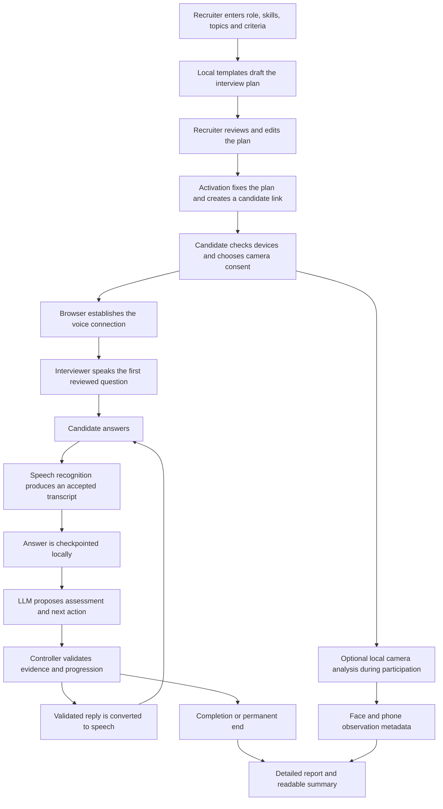
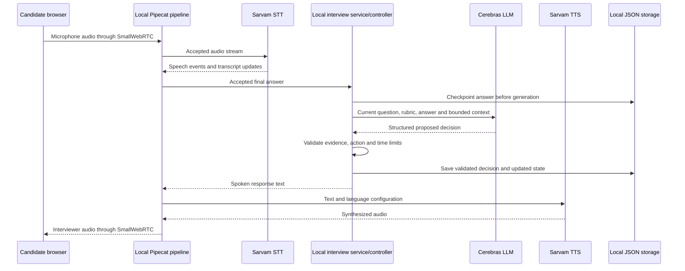
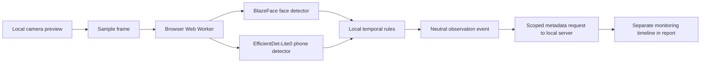

# AI Interview System: Complete Workflow and Architecture

This guide describes the implemented local-development prototype as of October 29, 2026. It is intended for a project presentation and explains the workflow, models, component connections, data handling, and current limitations.

## 1. Project overview

The system conducts a structured multilingual voice interview using a recruiter-reviewed question plan. It transcribes candidate answers, proposes evidence-based assessments and follow-up questions, validates those proposals in application code, and produces a recruiter report.

With candidate consent, it also analyzes camera frames locally for face-related observations and possible mobile-phone sightings. Camera observations are separate from technical assessment.

The system supports English (`en`), Hindi (`hi`), Kannada (`kn`), Marathi (`mr`), and Telugu (`te`).

The final report supports human evaluation. It does not make an automatic hiring decision.

## 2. Overall workflow



## 3. Technologies and models

These are the configured models at the time of writing. Voice settings are snapshotted for each media call; camera settings are stored in the activated interview definition. Later configuration changes do not rewrite earlier interviews.

| Component | Technology or model | Responsibility | Execution location |
|---|---|---|---|
| Backend | Python, FastAPI, Uvicorn | Routes, validation, lifecycle and local persistence | Local server |
| Audio orchestration | Pipecat | Connect audio, transcription, interview responses, speech synthesis and metrics | Local server |
| Browser audio transport | SmallWebRTC | Carry browser microphone input and interviewer audio | Browser and local server |
| Speech-to-text | Sarvam `saaras:v3-realtime` | Convert speech into transcript text | External Sarvam API |
| Interview decision model | Cerebras-hosted `qwen-3.8-27b` | Propose answer assessments, clarification and follow-ups | External Cerebras API |
| Text-to-speech | Sarvam `bulbul:v3`, configured voice `shubh` | Convert interviewer text into spoken audio | External Sarvam API |
| Voice activity analysis | `SileroVADAnalyzer` | Supply local speech activity/timing signals used by the pipeline and latency observers | Local server |
| Vision runtime | `@mediapipe/tasks-vision` version `0.10.32`, WebAssembly, CPU delegate | Execute face and object models | Candidate browser worker |
| Face model | BlazeFace short-range, float16, version 1 | Detect faces and their positions | Candidate browser worker |
| Phone model | EfficientDet-Lite0, int8, version 1 | Detect the allowed `cell phone` category | Candidate browser worker |
| Persistence | Typed, versioned JSON files | Save definitions, progress, reports and conversation logs | Local server disk |
| Readable report summary | Browser JavaScript | Summarize existing saved evidence | Recruiter browser |

The configured LLM uses `reasoning_effort: none`. Interview decisions are requested as structured JSON and validated before use. The configured model identifier is recorded here from the project settings; this guide does not independently verify the provider's model architecture.

MediaPipe is the vision execution library. BlazeFace and EfficientDet-Lite0 are the actual detection models.

## 4. Recruiter setup and plan review

The recruiter opens `/interviews` and supplies:

- Job title, description and expected experience.
- Skills and technical topics.
- Assessment criteria.
- Interview language and duration.
- Optional pasted resume text.
- Camera analysis settings, including whether mobile-phone detection is enabled.

### Drafting

The draft planner uses deterministic local templates. It does not call an LLM or incur a provider request for drafting.

It creates technical sections from the supplied topics, suggests mappings to supplied skills, assigns question IDs and time budgets, and reserves a final candidate-question section. Recognized algorithm-problem topics receive a problem-solving prompt; other topics receive an implementation-oriented template.

This draft is a starting point. The recruiter must review question wording, difficulty, language, criteria, skill mappings and timing. The optional resume is source context, not a guarantee of automatically tailored questions.

### Activation

The recruiter saves the reviewed plan and activates it. Each technical question must have a supplied skill mapping. Activated definitions are immutable so that the interview remains tied to the same reviewed requirements.

To change or reuse an activated plan, the recruiter copies it into a new interview, reviews it and activates the new version.

## 5. Candidate link and preparation

Activation creates a candidate session and a private participation link containing a random bearer token. The server stores only the token's SHA-256 hash. The original link must be retained because the token cannot be retrieved later from that hash.

The candidate page moves the fragment token into tab-scoped session storage and removes it from the visible URL. The token is scoped to candidate participation for that session; it does not authorize access to recruiter reports.

Before starting, the candidate can check microphone availability and input level, play a local test tone, and preview the camera. The candidate explicitly chooses whether to consent to local camera analysis and metadata delivery.

Camera preview alone does not start interview analysis. Analysis requires participation and consent. Camera denial does not block the voice interview.

## 6. How the voice components connect



### Connection readiness

The session manager owns the WebRTC peer and live pipeline. Before speaking the introduction and first question, the system waits for media, browser playback/protocol readiness and the Sarvam transcription session.

Pipeline-facing input and output audio remain fixed at **16,000 Hz**. Browser hardware may use a different native rate; the transport handles conversion at that boundary.

### Turn-taking and transcription

The current interview uses a no-barge-in policy: microphone input is gated while the interviewer is speaking or a response is reserved. The candidate answers after the interviewer finishes.

Sarvam supplies interim and final transcripts. Interim text does not trigger an assessment. Accepted finals are deduplicated before entering saved interview state and response generation.

Interview mode holds final text for a short continuation window, using the snapshotted turn-stop setting. At its default, this hold is 500 milliseconds. Speech resuming within that window can combine accepted chunks into one answer before checkpointing. Provider silence detection and a separate aggregation debounce also affect the wait.

This mechanism reduces some premature turn endings, but it does not guarantee that every natural pause is handled correctly.

## 7. Answer assessment and progression

### What the LLM receives

For a technical turn, the interview service supplies the current reviewed question and criteria, accepted transcript, relevant job source data, bounded earlier-turn context, conversation memory, terminology hints, follow-up usage and remaining time.

The memory layer uses a bounded recent window, rule-extracted facts, deterministic compaction and lexical recall. It does not require another LLM request. Previous context can help the conversation, but evidence for the current assessment must come from the current accepted answer.

Camera observations are excluded from technical generation.

### What the LLM proposes

The structured decision includes the question ID, turn kind, next action, spoken text, assessment evidence and any technical issue. Available actions are:

- `clarify`
- `follow_up`
- `next_question`
- `next_section`
- `finish`

Wrong, vague, off-topic and don't-know answers are ordinary interview inputs. The intended handling is a relevant clarification, polite redirect or progression within the reviewed limits.

### Why a controller is needed

The LLM proposes a decision; application code owns progression. Normalization and controller checks verify that:

- The decision refers to the current question.
- Criterion names belong to the reviewed rubric.
- Supporting excerpts occur in the accepted transcript.
- Positive ratings contain supporting excerpts.
- Follow-ups are grounded in the answer.
- Requests and closing turns do not become technical assessments.
- Spoken output excludes control data and inappropriate multi-question prompts.
- Follow-up, request, section and overall time limits are enforced.

Some recoverable output problems can be repaired while retaining independently valid evidence. An unusable decision can fall back to a reviewed prompt without another provider request. A real provider timeout or network failure can pause the interview.

These checks reduce invalid output; they do not establish that every accepted assessment is semantically correct.

### Example

For a reviewed palindrome question, a candidate might explain placing one pointer at each end and comparing characters while moving inward. The LLM can propose an assessment against the reviewed algorithm criterion and a grounded follow-up about termination or mismatches.

The controller validates the proposed evidence and limits. Only the resulting spoken question is sent to speech synthesis; JSON and assessment notes are not read aloud.

## 8. Multilingual speech output

The selected interview language guides the introduction, reviewed questions and generated spoken responses. Sarvam STT normally uses automatic language detection, while the interview language remains part of the reviewed definition.

The pipeline uses an internal language prefix to configure Sarvam TTS for the response. That prefix is removed before synthesis, so it is not spoken to the candidate.

Interview mode waits for the structured decision to be returned and validated before emitting its spoken text. TTS then synthesizes audio for browser playback. The interview decision itself is not streamed token by token to the candidate.

## 9. Local camera analysis

The browser obtains a camera stream using browser permission. With consent and participation, it samples frames and transfers an `ImageBitmap` to a dedicated Web Worker.



### Face detection

The worker loads `blaze_face_short_range.tflite`: **BlazeFace short-range, float16, version 1**. It runs through MediaPipe Face Detector in VIDEO mode using the CPU delegate and local WebAssembly assets.

The detector supplies face counts, detection scores and positions. Local rules use these observations to identify sustained face absence, multiple faces and position changes relative to an initial detected position.

This is face detection. It does not verify identity, recognize a registered candidate, measure gaze or determine attention, emotion or honesty.

### Phone detection

The worker loads `efficientdet_lite0.tflite`: **EfficientDet-Lite0, int8, version 1**. It runs through MediaPipe Object Detector using the CPU delegate. Its category allowlist contains only `cell phone`.

The current feature is therefore limited to possible mobile phones. It does not flag arbitrary suspicious objects or infer whether a visible phone is being used.

Both models and the pinned MediaPipe WASM assets are served locally. Setup downloads the model files and checks their expected SHA-256 hashes; runtime camera inference does not call an external vision API.

### Cadence and performance

Face analysis defaults to 4 frames per second, using a 640-by-360 processing path. Phone analysis defaults to 2 frames per second in the same worker, with a 320-by-320 detector canvas.

These are target cadences, not guaranteed throughput. Only one frame is in flight at a time. If inference is busy, frames are skipped instead of building an increasing backlog. Transferred bitmaps are closed after processing.

Using a worker keeps model execution off the main UI thread, but CPU inference still consumes device resources. Real performance depends on hardware, browser and workload.

## 10. How detections become saved events

A detector result does not automatically become a report event. Temporal rules require sustained observations and apply cooldowns to reduce brief or repeated alerts.

Factory defaults are listed below. Recruiter settings are saved with each activated definition; an individual interview may use different values, such as a calibrated phone threshold of 0.30.

| Rule | Default |
|---|---|
| Face model minimum confidence | 0.60 |
| Face absence duration | 3 seconds |
| Multiple-face duration | 2 seconds |
| Position-change duration | 3 seconds |
| Face event cooldown | 15 seconds per event type |
| Phone detection enabled | Off until the recruiter enables it |
| Phone event score threshold | 0.70 |
| Phone sustained observation span | 2 seconds |
| Phone event cooldown | 15 seconds |

Phone events require both the configured span and at least `ceil(phone_sustain_secs * phone_fps) + 1` positive observations. With the default cadence and span, that means at least five above-threshold samples.

One isolated missed sample can be tolerated within the cadence-derived gap bound. Repeated misses or long gaps reset the pending sighting. Consequently, a saved duration describes an observation span, not proof of uninterrupted visibility.

For local troubleshooting, phone candidates down to score 0.30 can appear in preview diagnostics. The configured event threshold still decides which observations qualify for a report event. A model score is not a calibrated probability.

The preview distinguishes events created from events acknowledged as saved. Metadata delivery is serialized, bounded and retried; an event is shown as saved only after server acknowledgement.

## 11. Monitoring coverage and privacy

The camera feature sends observation metadata and processing summaries, including timestamps, event type, counts, scores, analyzed-frame counts, coverage estimates and availability/gap information.

Camera images, recordings, face landmarks and bounding boxes are not uploaded or persisted by this monitoring feature. Local detection positions can be used transiently to derive position-change events.

The server validates the candidate scope, consent, event shape, timing, sequence and retry identity. These checks do not independently verify the contents of a candidate-controlled browser.

Processed-frame counts show that inference ran; they do not prove detection accuracy. Loading time, failures, long gaps and unconfirmed tails remain unknown. No saved phone sighting does not establish that a phone was absent.

Monitoring failures are reported separately so that voice participation can continue. Candidate consent can be withdrawn, which stops camera resources.

## 12. Pause, resume and completion

Pause checkpoints the interview, attempts a bounded final metadata flush, drains the voice pipeline and closes camera resources. Paused wall time is excluded from the active interview budget.

Resume creates a new media connection while retaining saved questions, answers and evidence. It repeats the pending prompt; an already-saved answer awaiting a decision remains available for retry. Bounded recent spoken context is restored.

With camera consent still enabled, Start/Resume acquires a fresh camera stream or reuses a live preview. If camera access is denied, voice can proceed with unavailable monitoring.

Normal progression or the active-time deadline completes the interview. Explicit permanent ending marks an unfinished session abandoned and prevents resume. After a process restart, a formerly live session becomes paused with an interruption issue; recovery is not seamless media continuation.

Cleanup waits for pipeline cancellation and runner completion before finalizing the conversation log once. Media resources, workers and tracks are released.

## 13. Storage and report generation

The local server stores separate typed, versioned JSON records:

```text
data/
  runtime_config.json          Voice behavior settings
  interviews/
    definitions/<id>.json      Job details and reviewed plan
    sessions/<id>.json         Answers, progress, evidence and monitoring
    reports/<id>.json          Derived recruiter report
  conversations/              Original voice-call transcripts and metrics
```

Answers are checkpointed before decision generation. Decisions and state changes are saved before their resulting speech is emitted. Individual file writes are atomic, but the set of files is not a database transaction.

The session is authoritative, and its report can be reconstructed. This design supports a local prototype without a database service.

### Detailed report

The report includes interview status, active duration, reviewed plan, asked questions, accepted transcripts, criterion evidence, skill coverage, missing evidence, uncertainty, technical issues, a separate camera timeline, monitoring coverage and human-owned notes/decision fields.

### Criterion ratings

| Rating | Meaning |
|---|---|
| Not assessed | No usable assessment was recorded |
| Insufficient evidence | The recorded answer does not supply enough evidence for the criterion |
| Developing | Evidence partly addresses the criterion, with a gap |
| Meets | Evidence concretely addresses the reviewed criterion |
| Strong | Evidence addresses the criterion and explains reasoning or tradeoffs |

Missing evidence does not prove missing ability. Assessments concern transcript content, which may contain recognition errors.

### Readable summary

Below the detailed JSON, browser code generates a readable section table, criterion reasons, possible phone sightings, face observations, coverage and technical issues. It makes no additional LLM request.

For each question/criterion it uses the strongest usable saved assessment across answers and follow-ups. Positive ratings require valid transcript excerpts. It distinguishes incomplete assessment coverage from recorded insufficient evidence. Closing is not scored.

Phone findings never change technical ratings. The report does not calculate a validated numeric ability score or automatically recommend hiring or rejection.

## 14. Main implementation connections

| File or module | Responsibility |
|---|---|
| `main.py` | Application startup, shutdown and route registration |
| `app/routers/interviews.py` | Recruiter and scoped candidate HTTP routes |
| `app/services/browser_session.py` | Live WebRTC peer, one active runner and cleanup |
| `app/services/pipecat_pipeline.py` | Audio processing, provider wiring, memory and observers |
| `app/services/sarvam_realtime_stt.py` | Sarvam realtime protocol, transcript acceptance and continuation hold |
| `app/interviews/planning.py` | Local draft templates and plan-review checks |
| `app/interviews/models.py` | Typed interview and camera data models |
| `app/interviews/service.py` | Interview orchestration, decision requests, checkpoints and recovery |
| `app/interviews/processor.py` | Connect interview responses to Pipecat frames |
| `app/interviews/decisions.py` | Normalize and validate proposed evidence and speech |
| `app/interviews/controller.py` | Authoritative progression, limits and session transitions |
| `app/interviews/vision.py` | Monitoring metadata validation and coverage handling |
| `app/interviews/store.py` | Local interview record persistence |
| `app/interviews/report.py` | Derive the recruiter report from saved state |
| `frontend/recruiter.js` | Interview creation, review, activation and report UI |
| `frontend/candidate.js` | Preparation, consent, participation and camera lifecycle |
| `frontend/demo.js` | Shared browser voice client and turn-taking UI |
| `frontend/camera-monitor.js` | Sample frames, coordinate the worker and deliver metadata |
| `frontend/camera-worker.js` | Execute local face and phone models |
| `frontend/camera-rules.js` | Sustained face-observation rules |
| `frontend/phone-rules.js` | Sustained phone-sighting rules |
| `frontend/report-summary.js` | Readable report derived from saved evidence |

## 15. Local and cloud boundaries

| Data or operation | Where it goes |
|---|---|
| Candidate speech | Through the local backend to Sarvam STT |
| Transcript and relevant interview context | Through the local backend to Cerebras for decisions |
| Interviewer response text | Through the local backend to Sarvam TTS |
| Camera frames | Stay in the candidate browser for local inference |
| Camera observation metadata | Sent to the local FastAPI server |
| Definitions, sessions, transcripts and reports | Saved on local server disk |

The system therefore uses local camera analysis alongside cloud speech and language services. Voice-provider connectivity is required during an interview. Model downloads at setup also require connectivity.

API credentials remain server-side. Behavior settings are stored in local JSON; secrets belong in `.env`. Recruiter access is restricted to local development. A candidate bearer link is not a replacement for public-deployment authentication.

## 16. Prototype limitations and honest demonstration claims

- One active audio interview is supported at a time, using one server worker.
- Public multi-user deployment, recruiter authentication and production network infrastructure are outside the implemented scope.
- Speech recognition and turn boundaries can be wrong. Natural pauses can still cause premature answer acceptance.
- Known assessment issues remain: cut-off speech can still receive insufficient-evidence ratings in some cases, and a nonverbal transcript such as a cough can consume a turn/follow-up allowance.
- Time limits can leave technical sections unasked. A completed session does not mean every topic was assessed.
- Face and phone models can miss objects or produce false detections, especially with poor lighting, occlusion or unfavorable camera angles.
- Lowering a phone threshold can increase sensitivity and false alerts; it needs comparison testing with phones and non-phone objects.
- Monitoring metadata is client-reported and can be manipulated. It is not independent evidence of misconduct.
- Automated tests verify schemas, protocol ordering, routes, validation, state, persistence and cleanup. They do not prove real speech quality, audible latency or camera recognition accuracy.
- Human browser interviews and manual report review remain necessary.

For a demonstration, run a practice interview, use clear lighting, enable phone detection in the reviewed settings if needed, and retain a completed report in case a provider connection fails.

## 17. Short presentation script

> Our project is a multilingual AI interview prototype. The recruiter defines the job, topics, skills and assessment criteria, reviews a locally drafted question plan, and generates a private candidate link. The candidate checks their devices and participates through a browser voice connection.
>
> Sarvam Saaras converts speech to text. The Cerebras-hosted Qwen model proposes assessments and follow-up questions in structured JSON. A separate Python controller checks transcript evidence and enforces the reviewed interview rules before Sarvam Bulbul converts the approved response to speech.
>
> With consent, BlazeFace and EfficientDet-Lite0 run locally in a browser worker to detect face-related observations and possible phones. Camera frames remain in the browser; only observation metadata reaches the server. These signals are separate from technical assessment.
>
> Finally, local JSON records produce a detailed report and a readable section summary. The report helps a human review the candidate's demonstrated answers. It does not make an automatic hiring decision, and the current prototype still needs improvement around speech pauses, grading fairness and detection accuracy.

## 18. Related documentation

- [Interview operation, recovery and acceptance checks](INTERVIEWS.md)
- [Application architecture](ARCHITECTURE.md)
- [Latency and turn timing](LATENCY.md)
- [Metrics and observability](METRICS.md)
- [Conversation memory](MEMORY.md)
- [Approved video monitoring plan](VIDEO_MONITORING_PLAN.md)
- [Runtime configuration](CONFIGURATION.md)
