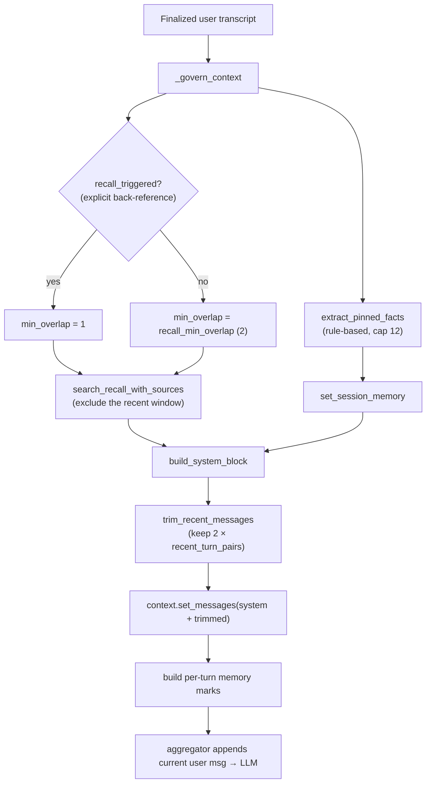
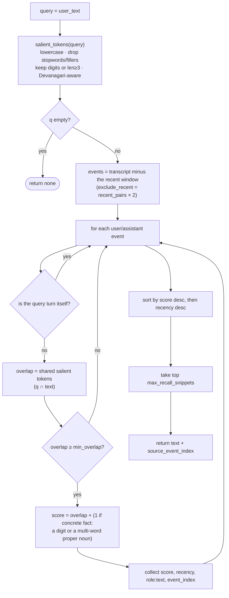

# In-Call Memory

A bounded, **deterministic** memory for short (20–30 turn) calls — with **no extra LLM calls**. It keeps
the model grounded in what was said earlier without ever dumping the whole transcript into the prompt.

> All logic lives in [memory.py](../app/services/memory.py) (pure, JSON-safe); the orchestration is
> `MemoryProcessor._govern_context` in the pipeline.

---

## 1. Four components

The system prompt is reassembled **fresh on every finalized user turn** from four parts:

| Component | What | Cost |
|---|---|---|
| **Recent window** | The last `2 × recent_turn_pairs` messages, kept **verbatim** in the LLM context. | free (already in context) |
| **Pinned facts** | Durable facts extracted by **rules** (no LLM) — "my name is…", "I prefer…", "remember that…". | regex |
| **Running summary** | A cheap deterministic compaction of *older* turns, activated only once the call is long. | string work, **post-turn** |
| **Lexical recall** | Query-relevant *older* snippets surfaced by content-token overlap. | set intersection |

The **full transcript** is persisted (for the Call Detail page) but is **never injected wholesale**.

---

## 2. Per-turn rebuild

`MemoryProcessor` sits **before the user aggregator**, so it governs the context *before* the new user
message is appended. It fires on each finalized `TranscriptionFrame`:



The whole context is **replaced** each turn (govern-then-overwrite): a fresh system message plus the
trimmed recent history. The current user message is appended afterward by the downstream aggregator.

---

## 3. System-block assembly order

`build_system_block` joins parts with blank lines, in a **deliberate** order:

```
┌─ FIXED (always kept in full) ──────────────────────────────┐
│ 1. RESPONSE_LANGUAGE_POLICY   ← the <en>/<hi> output contract│
│ 2. FACTUAL_GUARDRAIL          ← no-fake-specifics rule       │
│ 3. persona system prompt      ← the editable persona         │
│ 4. weak language hint         ← from STT (optional)          │
├─ DYNAMIC (budgeted, highest-value first) ──────────────────┤
│ 5. Known facts for this call: …    ← pinned facts            │
│ 6. Possibly relevant earlier turns (quotes): …  ← recall     │
│ 7. Earlier in this call: …         ← running summary (lossy) │
└────────────────────────────────────────────────────────────┘
```

> 🔒 The code-owned **language protocol + factual guardrail are placed *before* the persona** so a
> persona's own examples or creative leeway can't override them. Recalled assistant lines are shown **as
> quotes** ("you said earlier…"), never asserted as truth.

### Token budget
Only the **dynamic** sections (5–7) are budgeted, at `max_memory_block_tokens × 4` chars (token ≈ 4
chars). Iterating in priority order: a section that fits is kept; one that doesn't is partial-truncated at
a word boundary (and everything lower-priority is dropped). So **pinned facts > recall > summary** under
pressure, and a big memory block **cannot silently inflate LLM TTFB**. The fixed prefix (protocol /
guardrail / persona / hint) is never budgeted.

---

## 4. Lexical recall (the interesting bit)

Recall **always runs** a search; only the *injection* is score-gated. An explicit back-reference ("you
already told me…", "pehle kya bola…") relaxes the overlap threshold from 2 to 1 — it never gates whether
recall happens.



- **Excludes the recent window** (`exclude_recent = recent_turn_pairs × 2`) — those turns are already
  verbatim in context, so recall only surfaces *older* material.
- **Skips the query turn itself** so your current sentence can't be recalled back to you.
- **Concrete-fact boost** — lines with a number or a multi-word proper-noun run (places, lists) rank
  higher.
- **Source provenance** — each snippet carries its `event_index`, so the dashboard can show "from turns
  2, 7".

### Hinglish / Devanagari handling
The tokenizer regex includes the Devanagari block (`U+0900–U+097F`) explicitly, because Python's `\w`
drops Devanagari combining vowel marks and would shatter a Hindi word like "हिंदी" into base consonants.
The stopword set also includes romanized-Hindi fillers (`haan`, `acha`, `bhai`…) and particles (`hai`,
`tha`, `ko`, `ka`, `mein`…) so **content tokens dominate in Hinglish**. Without this, Hindi recall would
silently fail.

---

## 5. The running summary (stale by design)

The summary is refreshed **after** the reply (in `_on_turn_record`), never on the hot path — so it adds
zero latency to STT→LLM→TTS. It only activates once `turn_count ≥ enable_running_summary_after_turn` (10)
and then refreshes every `summary_update_every_turns` (5). Early in a call there is no summary at all; the
summary the model sees on turn N was computed at the end of an earlier due turn. It compacts only *older*
turns (excluding the recent window) into `Earlier in this call: …`, capped at `max_summary_tokens × 4`
chars.

---

## 6. Per-turn memory marks (for the dashboard)

Every `_govern_context` also produces a snapshot attached to the turn record as `rec["memory"]`:

```python
{
  "recall_used": bool,            # snippets were INJECTED (opportunity, not proof of use)
  "recall_triggered": bool,       # an explicit back-reference cue matched
  "recall_min_overlap": int,      # 1 (triggered) or 2 (default)
  "recall_snippets": list[str],   # capped 200 chars each
  "recall_source_turns": list[int], # event_index of each injected snippet
  "pinned_facts": list[str], "pinned_facts_count": int,
  "running_summary_present": bool,
  "context_message_count": int, "memory_block_char_len": int,
  "approx_memory_tokens": int     # char // 4 — NOT a real tokenizer count
}
```

These are pinned via the same **snapshot-at-promote** pattern as the speculation marks (captured at turn
queue time *and* re-captured at LLM-response start), so a merged turn records the **last sub-utterance's**
memory — the one that shaped the reply — and a turn with no bot reply still keeps its own marks. The
dashboard's `_memory_summary` rolls these up (recall-use rate, snippets injected, median context size,
median tokens). See [METRICS](METRICS.md) §6.

> `recall_used` means relevant context **was available** — an opportunity signal, not proof the LLM
> leaned on it. `approx_memory_tokens` is a char/4 estimate, not provider token usage.

---

## 7. Configuration

All under `runtime_config.memory` ([MemoryCfg](../app/models/runtime_config_models.py)):

| Knob | Default | Effect |
|---|---|---|
| `recent_turn_pairs` | `6` | Verbatim window size (kept `2N` messages); also sets `exclude_recent` for recall and the summary window. Higher = more context, larger prompt, higher TTFB. |
| `max_pinned_facts` | `12` | Cap on durable facts (most-recent kept on overflow). |
| `max_recall_snippets` | `2` | Older snippets injected per turn. |
| `recall_min_overlap` | `2` (1–6) | Min content-token overlap to inject a snippet; relaxed to 1 on an explicit back-reference. |
| `max_memory_block_tokens` | `600` (100–2000) | Budget (≈ chars/4) for the dynamic facts+recall+summary block — caps TTFB inflation. |
| `enable_running_summary_after_turn` | `10` | Summary stays off until this turn count. |
| `summary_update_every_turns` | `5` | Summary refresh cadence. |
| `max_summary_tokens` | `250` | Summary length budget. |
| `recall_only_when_user_asks` | `true` | **Deprecated / unused** — recall is always-on; injection is score-gated. |

Editable on `/config`: `recent_turn_pairs`, `enable_running_summary_after_turn`,
`summary_update_every_turns`, `recall_min_overlap`, `max_memory_block_tokens`.

---

## 8. Gotchas

- **Recall always *searches*; only *injection* is gated.** The "explicit ask" detection only relaxes the
  overlap threshold; `recall_only_when_user_asks` is deprecated.
- **All token budgets are char/4 approximations**, not a real tokenizer — they can drift from the actual
  LLM tokenization.
- **Only the dynamic sections are budgeted.** A huge persona prompt is *not* bounded by
  `max_memory_block_tokens`.
- **The summary is intentionally stale** — refreshed post-turn and only when due; absent early in a call.
- **Pinned-fact dedupe is exact-string** (after 160-char truncation), so near-duplicate rephrasings each
  consume a slot.
- **The speculative draft path** reuses the exact same `build_system_block` but strictly **read-only** (no
  setters, no fact extraction) and copies history dicts to avoid double-mutation. See
  [SPECULATION](SPECULATION.md).
