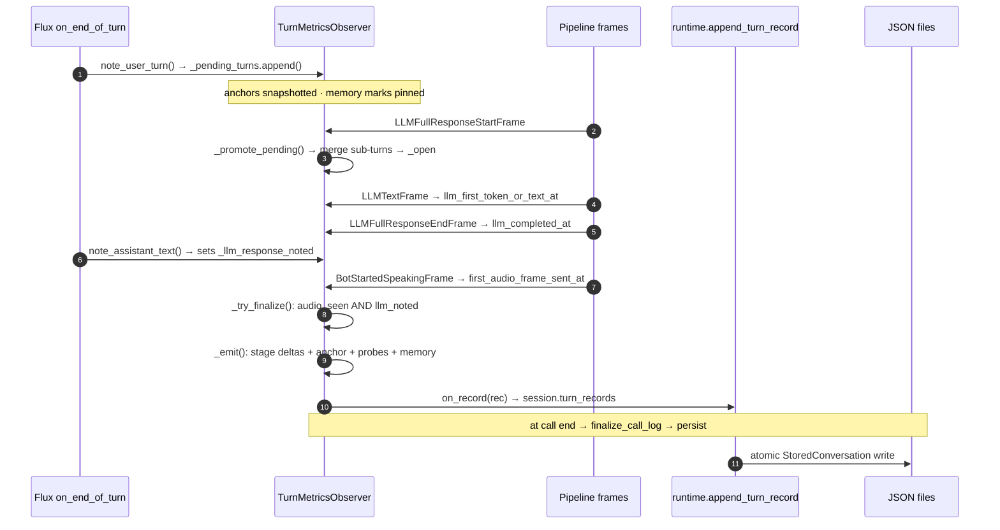
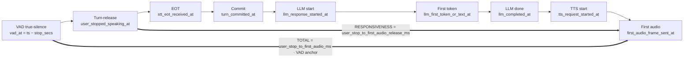
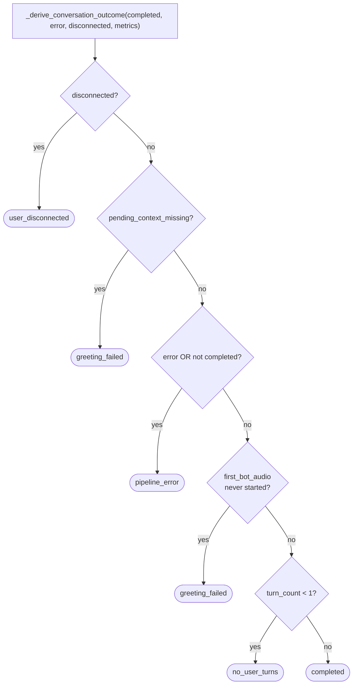

# Metrics & Observability

The current Sarvam path commits through its accepted-final callback. Historical Flux
terminology and eager-probe fields below describe existing saved records; Sarvam does
not collect eager probes or run speculative drafts. Observer registration is unchanged.

Every call produces a deep, per-turn metrics trail so any latency or failure can be localized to one
stage. This doc covers the observer, the per-turn record, the timing anchors, the call-outcome
taxonomy, and how the dashboard renders it all.

> **Companion:** [LATENCY](LATENCY.md) explains *why* the numbers look the way they do.

---

## 1. How timing is captured

A single `TurnMetricsObserver` ([call_metrics.py](../app/services/call_metrics.py)) — a Pipecat
`BaseObserver` attached to the `PipelineTask` — watches **every downstream frame push** and fills
timestamps. Facts that frames can't carry (text, language, errors, memory) arrive through **side-channel
methods** the pipeline calls:

| Side channel | Called from | Carries |
|---|---|---|
| `note_user_turn` | accepted Sarvam final callback | queues a pending turn with user text + stop anchors |
| `note_assistant_text` | `LanguagePrefixProcessor` | the spoken reply — the **authoritative "LLM done"** signal |
| `note_language` | `LanguagePrefixProcessor` | detected + response language |
| `note_memory_timing` | `MemoryProcessor` | memory governance duration + context size |
| `note_error` / `note_provider_error` | parser / service `on_error` | error stage label |

Frames fill the rest: `BotStartedSpeaking` → first audio, `LLMFullResponseStart` → response start,
`LLMTextFrame` → first token, `LLMFullResponseEnd` → LLM done, `TTSStarted` → TTS start,
`VAD/UserStopped` → stop anchors.

---

## 2. The per-turn record lifecycle

Each turn is one `TurnRecord` dict that flows through **queue → promote → fill → finalize → emit →
persist**:



1. **Queue** — `note_user_turn` builds a pending dict with the user text, the stop/EOT/commit anchors,
   and ~30 fields set to `None`. The memory marks snapshot is pinned **here** too, so a turn that never
   gets a bot reply still carries *its own* memory marks.
2. **Promote** — on `LLMFullResponseStartFrame`, `_promote_pending` merges all queued sub-turns into one
   `_open` record (overlapping turns are **merged, never overwritten**) and stamps the response-start
   time.
3. **Fill** — frame observation stamps the LLM/TTS/audio timestamps onto `_open`.
4. **Finalize** — `_try_finalize` fires once **both** first-audio *and* `note_assistant_text` are seen.
5. **Emit** — `_emit` computes every stage delta, picks the primary anchor, attaches the eager/memory
   probes, and calls `on_record` → `append_turn_record` (which JSON round-trips the record into the
   session and refreshes the running summary).
6. **Persist** — at call end, `finalize_call_log` packages all records into a `CallLog` and writes it to
   a versioned JSON envelope under `data/conversations/`.

---

## 3. The latency anchors (the heart of it)

There are **three** user-stop anchors, and the difference between them *is* the latency story:

| Anchor | Source | Meaning |
|---|---|---|
| `user_stopped_speaking_vad_at` | `VADUserStoppedSpeakingFrame.timestamp − stop_secs` | **VAD true-silence** — the honest start of the wait |
| `user_stopped_speaking_at` | `UserStoppedSpeakingFrame` (earliest, for merged turns) | **turn-release** — later than true silence by the VAD window + debounce |
| `latest_user_stopped_speaking_at` | turn-release of the **last** sub-utterance | used for **responsiveness** so a mid-thought pause isn't counted as backend latency |



The headline `user_stop_to_first_audio_ms` (alias `primary_latency_ms`) **prefers the VAD anchor**
(`primary_latency_anchor = "vad"`) and falls back to the turn-release anchor when no VAD frame was seen
(`"turn_release"`).

### Stage-breakdown fields

Each delta localizes time to exactly one stage (all in ms; `None` when an endpoint is missing):

| Field | Span | Stage |
|---|---|---|
| `user_stop_to_eot_ms` | stop → EOT | STT / endpointing |
| `eot_to_turn_committed_ms` | EOT → commit | aggregation |
| `turn_committed_to_llm_start_ms` | commit → LLM | pre-LLM queue (turn-stop debounce) |
| `earliest/latest_turn_committed_to_llm_start_ms` | (merged turns) | latest = true backend delay; earliest is inflated by the pause |
| `llm_ttfb_ms` | LLM start → first token | LLM time-to-first-byte |
| `llm_total_ms` | LLM start → done | full LLM stream |
| `llm_end_to_tts_start_ms` | LLM done → TTS | hand-off (≈ 0, streaming) |
| `tts_first_audio_ms` | TTS start → first audio | Sarvam synthesis |
| `earliest/latest_user_stop_to_first_audio_ms` | (merged turns) | release-anchored end-to-end |

---

## 4. Error attribution

- `error_stage` / `error_message` capture per-turn failures.
- `note_error` (from the language parser, e.g. `language_prefix_parse`, `llm_no_output`) **overwrites**
  unconditionally.
- `note_provider_error` (from STT/TTS/LLM `on_error` handlers, e.g. `tts_provider_error`) **only sets it
  if currently None**, so a more specific parser label wins.
- `_flush_incomplete` (on `EndFrame`/`CancelFrame`) stamps any still-open record
  `incomplete_at_call_end` and any unpromoted queued turn `no_bot_response`, so **no turn ID is ever
  lost**.

> Known telemetry-only limitation: a provider `ErrorFrame` from a background websocket task could land on
> the *next* turn's open record (the frame carries no turn key to correlate). It never affects call
> behavior — only which turn carries the label.

---

## 5. Call-outcome taxonomy

At call end, the V3 outcome is derived **purely from signals** (no slot flow), using a *structured*
`disconnected` flag — never substring-matching exception text:



| Outcome | Meaning |
|---|---|
| `completed` | Bot greeted, ≥ 1 user turn, no error |
| `no_user_turns` | Bot greeted but the caller never engaged |
| `greeting_failed` | The bot never produced audio (incl. outbound fail-closed) |
| `user_disconnected` | Caller hung up — a normal end, **not** an error |
| `pipeline_error` | The runner raised / aborted |

This replaced an older slot-era taxonomy that mislabeled healthy calls as "incomplete" and hang-ups as
"runtime_error".

---

## 6. The dashboard

`get_calls_list` and `get_call_detail` ([dashboard.py](../app/routers/dashboard.py)) read the records
back and compute call-level rollups.

### `_latency_summary` — responsiveness vs total
Two series, each with **avg / median / p95 / max + measured count `n`** (`_stat_block`):

- **responsiveness** — from `latest_user_stop_to_first_audio_ms` (felt latency; excludes endpointing and
  mid-thought pauses). The **headline** column, badged (warn 800 ms / crit 1500 ms).
- **total** — from `primary_latency_ms` (VAD-anchored physical wait). Shown muted.

Median is used, not avg — a few slow-LLM turns skew the mean. Null-latency turns are excluded but `n` is
surfaced (`median over n of total`) so the gap isn't hidden.

### Other rollups (call detail)
- **`_eager_probe_summary`** — eager rates, match rate, median/p95 head start, estimated-saved stats; and
  (when drafts ran) Stage-2 draft start/release/cancel counts, use/cancel rates, measured draft head
  start, and an empirical released-vs-normal comparison (using the *release* anchor to avoid mixing
  VAD/release anchors). See [SPECULATION](SPECULATION.md).
- **`_memory_summary`** — recall use/trigger rates, total snippets injected, median context messages,
  median/max approx memory tokens. See [MEMORY](MEMORY.md).

---

## 7. Persistence shapes

```python
# schemas.py
CallMetrics = { first_bot_speech_latency_secs, first_bot_audio_started_at, first_tts_frame_queued_at,
                greeting_*  , turn_count, turn_records: list[dict] }

CallLog = { call_sid, stream_sid, config_snapshot, metrics: CallMetrics,
            transcript: list[TranscriptEvent], completed, error,
            call_transport_status, conversation_outcome }
```

`turn_records` is an open `list[dict[str, Any]]` at every layer — adding a new per-turn field needs no
schema change (it JSON round-trips through `append_turn_record` into the local JSON payload). The full `TurnRecord` field
list is in §3 above plus the `eager_probe` and `memory` sub-objects.

---

## 8. Invariants & gotchas (why it's correct)

1. **Headline anchor duality** — `primary_latency_ms` is VAD-anchored *when a VAD frame was seen*, else
   turn-release. So the field isn't directly comparable across turns; speculation comparisons
   deliberately use the always-defined `user_stop_to_first_audio_release_ms`.
2. **Finalize gates on `note_assistant_text`, not the frame** — gating on `LLMFullResponseEndFrame` would
   race ahead and drop the spoken text + error stage on streamed replies.
3. **Stale-anchor guards** — a VAD anchor after the EOT or older than 30 s is rejected (the muted
   barge-in case); `VADUserStartedSpeakingFrame` clears a pending anchor.
4. **Merged turns** — primary anchor = *earliest* stop (honest wait start); responsiveness uses the
   *latest* (excludes the human pause); `latest_turn_committed_to_llm_start_ms` is the true backend
   delay.
5. **Promote-time snapshots** — speculation + memory marks are pinned at promote (and at queue time for
   unpromoted turns), never read live at emit, because a superseded turn N would otherwise grab turn
   N+1's marks.
6. **Superseded-response strays** — late `LLMTextFrame`/`End` frames from a superseded response are
   ignored, preventing impossible "LLM total 3 ms / TTFB —" records; a new response before finalize emits
   the old one as `superseded_by_new_response`.
7. **`stt_ready_before_user_turn` is tri-state** (True/False/None), not a one-way latch.
8. **Structured disconnect** — never inferred from exception text; `pending_context_missing` →
   `greeting_failed` is distinct from `pipeline_error`.
9. **`approx_memory_tokens` is char//4**, a budget unit, not a real tokenizer; **`recall_used`** means
   context was *injected* (opportunity), not proof the LLM used it.
