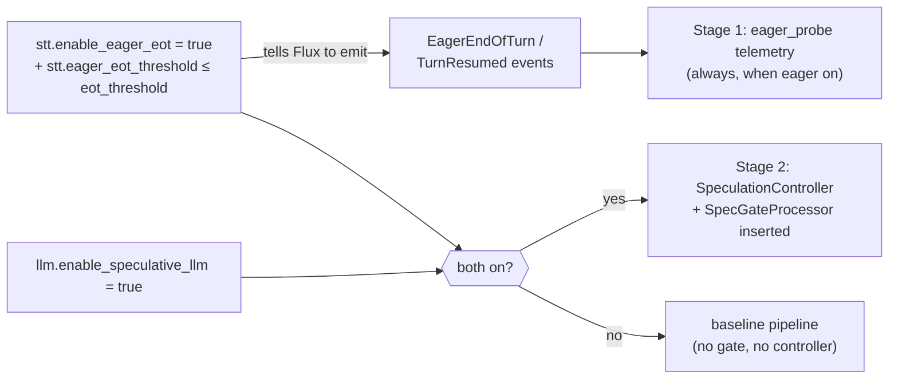
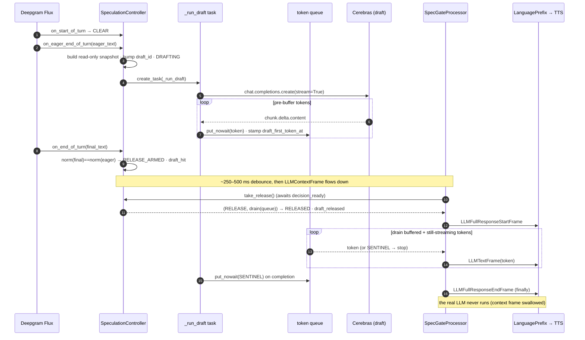

> Status: available in browser Settings. New-installation defaults are off; the repaired local
> setup enables both stages. See [configuration](CONFIGURATION.md).

# Speculative LLM

A two-stage, **default-OFF** latency optimization that hides the endpointing tail by drafting the reply
*before* the user is officially done speaking. Built on Deepgram Flux's **EagerEndOfTurn** /
**TurnResumed** turn-boundary events.

> **Why it exists:** the endpointing budget (~0.9–1.2 s of "are you done talking?") can't be cut below
> the truncation-risk floor. Speculation doesn't shrink it — it *fills* it with useful work. See
> [LATENCY](LATENCY.md) §5.5.

> ⚠️ **Off by default, byte-identical when off.** With `enable_speculative_llm=false` (default) the
> controller and gate are never constructed, the processor list splices in nothing, and the pipeline is
> exactly the baseline.

---

## 1. The two stages

| Stage | Flag | What it does | Speaks early? |
|---|---|---|---|
| **Stage 1 — EagerEOT telemetry** | `stt.enable_eager_eot` | **Measure only.** On each eager event, records the would-be head start and writes an *estimated* saving to the turn record. **No draft is ever run.** | No |
| **Stage 2 — Speculative draft** | `llm.enable_speculative_llm` | Starts an out-of-band Cerebras draft on the eager transcript, buffers its tokens privately, and at end-of-turn **releases the draft in place of the normal LLM** — but only on an exact transcript match. | No (released as the normal reply) |

Stage 2 requires Stage 1 (you can't draft without eager events). This is enforced twice: a RuntimeConfig
cross-field validator *and* an `AND` in the pipeline builder.

---

## 2. Gating & config



| Knob | Default | Effect |
|---|---|---|
| `stt.enable_eager_eot` | `false` | Master switch for eager events + Stage-1 telemetry. |
| `stt.eager_eot_threshold` | `none` (0.3–0.9) | The Flux eager confidence; **passing it is what turns eager events on**. Must be ≤ `eot_threshold`. Lower = earlier/more-frequent eager (bigger head start, more `TurnResumed` cancels). |
| `llm.enable_speculative_llm` | `false` | Master switch for Stage 2. Requires `enable_eager_eot`. |

The draft inherits the same `llm.model` / `temperature` / `max_tokens` and the same `memory.*` knobs as
the normal path (its context is built read-only from the same memory state).

---

## 3. Stage 1 — EagerEOT telemetry (measure only)

On every eager turn, `_finalize_eager_probe` computes hard facts and an estimate:

- **`head_start_ms`** = `final_eot_at − eager_eot_at` — how far ahead the eager event fired.
- **`eager_final_match`** = normalized eager transcript == normalized final transcript.
- **`verdict`** — a ladder: `no_eager_event` → `wasted_turn_resumed` → `missing_final_transcript` →
  `discarded_transcript_mismatch` → `not_enough_head_start` → `eligible_unmeasurable` → `eligible`.
- **`estimated_saved_ms`** (only for `eligible`):
  ```
  hypothetical_spec_first_token = eager_eot_at + (normal_ttfb)
  effective_ready               = max(final_eot_at, hypothetical_spec_first_token)
  estimated_saved_ms            = max(0, normal_first_token_at − effective_ready)
  ```
  Algebraically: `(EOT→LLM-start backend gap) + min(head_start, ttfb)`.

> This is an **estimate** — it *assumes* a draft's TTFB would equal the normal LLM's TTFB. No draft runs
> in Stage 1, so it quantifies the *missed opportunity*, not a realized saving. Use it to decide whether
> Stage 2 is worth enabling.

---

## 4. Stage 2 — the speculative draft

### Hard invariants (the safety contract)

1. **The draft never pushes pipeline frames or mutates session state** (memory/transcript/context/
   language/metrics) until it is *released*. Its context is built **read-only**.
2. A **monotonic generation guard** (`_draft_id`) rejects stale tokens from a cancelled/superseded draft.
3. **Every ambiguity degrades to the single normal-LLM fallback** — `TurnResumed`, transcript mismatch, a
   decision-not-ready race, a build failure, or a stream error all end with the real LLM running. Never
   wrong output, never double output.
4. The controller holds live `asyncio` objects, so it is **per-call and processor-owned** — never stored
   in `ACTIVE_SESSIONS`.

### The state machine

```mermaid
stateDiagram-v2
    [*] --> IDLE: construct
    IDLE --> CLEAR: on_turn_start (StartOfTurn)
    CLEAR --> DRAFTING: on_eager — start draft, bump draft_id
    CLEAR --> NORMAL_LLM: on_end_of_turn (no draft)

    DRAFTING --> RELEASE_ARMED: on_end_of_turn AND norm(final)==norm(eager) [draft_hit]
    DRAFTING --> NORMAL_LLM: on_end_of_turn AND mismatch [cancel]
    DRAFTING --> CLEAR: on_resumed / on_turn_start / on_interruption / draft_error [cancel]
    DRAFTING --> NORMAL_LLM: take_release decision_not_ready [cancel + latch]

    RELEASE_ARMED --> RELEASED: gate take_release consumes [draft_released]
    RELEASE_ARMED --> NORMAL_LLM: draft_error after arm
    RELEASE_ARMED --> CLEAR: on_turn_start / on_interruption [cancel]

    RELEASED --> CLEAR: next turn (response owned downstream; NOT cancelled)
    NORMAL_LLM --> CLEAR: next turn
```



| State | Meaning |
|---|---|
| `IDLE` | Quiescent between turns. |
| `CLEAR` | In a turn, no draft yet, awaiting eager. |
| `DRAFTING` | Out-of-band stream running, tokens buffering. |
| `RELEASE_ARMED` | EndOfTurn matched — release armed, gate not yet consumed. |
| `NORMAL_LLM` | Decided no usable draft → forward to the real LLM. |
| `RELEASED` | Gate consumed the release — the draft *is* the response. |

### A draft-HIT turn, end to end



The win: because tokens were pre-buffered during the endpointing tail, **`llm_ttfb_ms` reads ~0** on a
released turn — the wait is hidden behind tokens that already exist.

### The gate's three decisions
The `SpecGateProcessor` sits between the user aggregator and the LLM. On the turn's `LLMContextFrame` it
calls `take_release()`, which returns one of:

- **`RELEASE`** — armed and matched → swallow the context frame, drain the buffered draft as a normal LLM
  envelope (the real LLM never fires).
- **`SUPPRESS`** — already released, and a *duplicate* context frame arrived (merged/multi-inference
  turns) → swallow it so there's no second response.
- **`NORMAL`** — anything else (mismatch, resumed, or the **decision-not-ready double-response guard**) →
  forward the context frame to the real LLM.

---

## 5. Why it's safe under reordering

Flux dispatches its handlers as independent async tasks, so cross-handler ordering is best-effort. Every
transition is guarded by **state + a monotonic generation id + a `decision_ready` event**, so a worst-case
reorder degrades to the normal-LLM path. The subtle, load-bearing details:

- **Released-generation exemption** — a *released* draft keeps streaming even after the next turn's eager
  bumps the generation ids, otherwise the gate's drain would hang forever. Pre-release cancelled drafts
  still self-abort at their next chunk.
- **Sentinel discipline** — a cancelled *pre-release* draft posts no sentinel (its queue is abandoned); a
  *released* draft always posts one so the draining gate can close the envelope.
- **Double-response guard** — if the gate arrives before the decision is ready, after a bounded 0.5 s wait
  it cancels any in-flight draft and **latches** `NORMAL_LLM`, so a late arm can't release into an
  already-forwarded reply.
- **`_handle_draft_error` is synchronous and lock-free** — it runs inside the draft task, which
  `_cancel_active` awaits *while holding the lock*; taking the lock would deadlock.
- **Generation bump before cancel** — `_cancel_active` bumps `_draft_id` *before* awaiting `task.cancel()`,
  so an in-flight chunk self-aborts rather than appending a stale token.
- **`RELEASED` is never cancelled** by `on_resumed` / `on_turn_start` / `on_interruption` — it has become
  the active assistant response, owned by the normal downstream interruption policy.

---

## 6. Metrics: estimate vs measured

| Field | Stage | Meaning |
|---|---|---|
| `head_start_ms` | 1 | `final_eot_at − eager_eot_at` (hard fact) |
| `estimated_saved_ms` | 1 | estimate assuming draft TTFB = normal TTFB (no draft run) |
| `draft_started` / `draft_hit` / `draft_released` / `draft_cancelled` | 2 | draft outcome marks |
| `draft_used` / `normal_llm_used` | 2 | which path actually produced the reply |
| `extra_llm_call` | 2 | `1` if a draft started but wasn't released (a wasted Cerebras call) |
| **`draft_headstart_ms`** | 2 | **measured** `final_eot_at − draft_first_token_at` on a released turn |

> On a released turn, `llm_ttfb_ms ≈ 0` (tokens pre-buffered) — speculative analysis must use
> `draft_headstart_ms`, not provider TTFB.

The dashboard's `_eager_probe_summary` rolls these up (start/release/cancel counts, use/cancel rates,
median measured head start, and an *empirical* released-vs-normal latency comparison using the release
anchor to avoid mixing VAD/release anchors). See [METRICS](METRICS.md) §6.

---

## 7. The cost / when to enable

Speculation is a **capacity trade**: on a *miss* turn (mismatch / resumed) the draft was a wasted extra
Cerebras call (`extra_llm_call = 1`). It only pays off if Cerebras has the headroom to absorb the extra
load and respond quickly. The honest guidance: enable it only against a responsive Cerebras tier, watch
`additional_llm_call_rate` and `draft_use_rate` in the dashboard, and compare the *empirical*
released-vs-normal medians — not the Stage-1 estimate.
